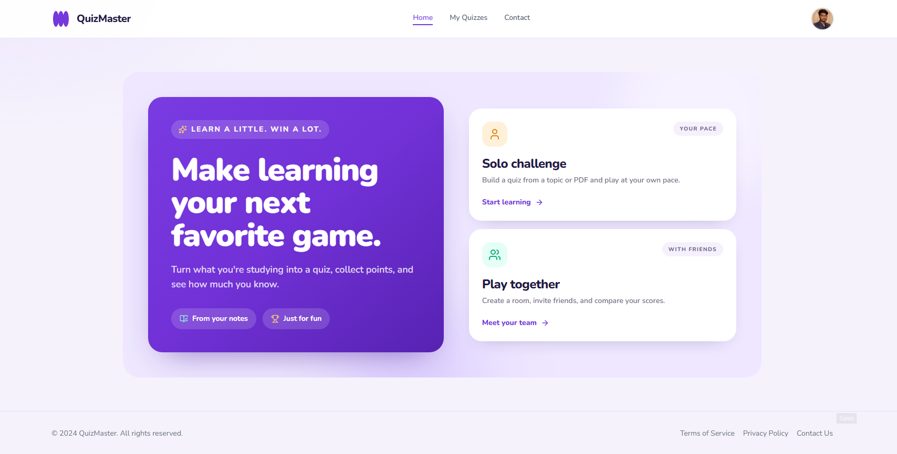

# QuizMaster Frontend

Next.js 15 and React 19 frontend for QuizMaster. The Flask API and Socket.IO server are maintained in the separate [backend repository](https://github.com/shoryatyagi/flask-backend).

## Project walkthrough

[](https://youtu.be/MbdkvGmE6mA)

## Run locally

### Prerequisites

- Node.js 20 LTS and npm
- Python 3.9+ for the backend
- MongoDB (Atlas or local), Firebase project, and Groq API key

### 1. Start the backend

Clone [flask-backend](https://github.com/shoryatyagi/flask-backend) alongside this repository. Follow its [local setup instructions](https://github.com/shoryatyagi/flask-backend#run-locally). In brief, configure its `.env` with MongoDB, Groq, Firebase Admin credentials and local CORS origins, then start Flask on `http://localhost:5000`.

### 2. Configure the frontend

From this repository's root, create the local environment file:

```powershell
Copy-Item .env.local.example .env.local
```

Edit `.env.local` and set:

- `NEXT_PUBLIC_API_URL=http://localhost:5000`
- `NEXT_PUBLIC_SOCKET_URL=http://localhost:5000`
- The six `NEXT_PUBLIC_FIREBASE_*` values from Firebase Console → Project settings → General → Your apps.

Firebase web settings are client-side configuration and are included in the browser bundle. Do not put MongoDB, Groq, Flask secret, or Firebase Admin credentials in this file. Enable Google sign-in in Firebase Authentication and authorize `localhost`.

### 3. Install and run

```powershell
npm ci
npm run dev
```

Open [http://localhost:3000](http://localhost:3000). Keep the backend terminal running too. Stop either server with `Ctrl+C`.

On macOS/Linux, copy the env example using `cp .env.local.example .env.local`; the npm commands are unchanged.

## Run with Docker locally

The frontend includes a Dockerfile and Compose file. Create `.env.local` as described above. The backend must be reachable from inside the frontend container; `localhost` inside a container points to that container, so use the backend host address (for Docker Desktop, often `host.docker.internal`) in the API and Socket.IO URLs.

```powershell
docker compose up --build
```

Visit `http://localhost:3000`. Stop and remove the container with `Ctrl+C`, then `docker compose down`.

## Deploy to AWS

There are two documented deployment methods. Both require the frontend and backend repositories and external Firebase, MongoDB, and Groq services.

### Option A: scalable ECS/Fargate stack

1. Read the complete [ECS/Fargate deployment guide](deploy/aws/README.md). It documents AWS costs, prerequisites, secrets, OIDC, GitHub settings, validation, and teardown.
2. Install AWS CLI v2, configure an AWS identity, and set up a budget alert. This stack is **not Free Tier only**; it creates an Application Load Balancer, NAT Gateway, four baseline Fargate tasks, Redis, ECR, logs, and networking.
3. Put MongoDB URI, Groq key, Firebase service-account JSON, Flask secret, and Redis auth token in AWS Secrets Manager. Never commit them.
4. Create the platform CloudFormation stack with `deploy/aws/ecs-platform.yml`, using the five secret ARNs. Optionally provide a domain and ACM certificate for HTTPS. Add the stack's NAT Gateway EIP to the MongoDB network allowlist.
5. Configure the required Actions variables and GitHub OIDC trust in both repositories as described in the guide. Add the six public Firebase web config values as frontend Actions variables.
6. Push to the configured deployment branches or manually run the workflows. Confirm both ECS services become healthy, then open the stack's `AppUrl` output and review CloudWatch logs and target health.
7. Delete the CloudFormation stack when finished; empty ECR repositories first if stack deletion reports they are not empty.

### Option B: single EC2 trial deployment

1. Read the full [EC2 deployment guide](deploy/ec2/README.md), including AWS account eligibility and cost/security notes. This deploys HTTP behind Nginx and is intended for a short trial, not production credentials or data.
2. Keep this frontend repository and `flask-backend` cloned side by side. Install Docker Desktop, AWS CLI v2, and Windows OpenSSH; authenticate the AWS CLI with a non-root identity allowed to manage the documented EC2 resources.
3. From this repository, copy `deploy/ec2/.env.deploy.example` to `deploy/ec2/.env.deploy`. Fill Firebase web values plus backend MongoDB, Groq, Flask secret, and compact Firebase service-account JSON values. Keep this file private.
4. In PowerShell at the frontend repository root, run:

   ```powershell
   Set-ExecutionPolicy -Scope Process Bypass
   .\deploy\ec2\deploy.ps1
   ```

5. Choose a region and eligible instance type, enter your public IPv4 address with `/32` for SSH access, review the resource details, and type `DEPLOY` when prompted. Add the instance's public IP to MongoDB's network allowlist if needed; authorize the deployed hostname/IP in Firebase Authentication.
6. Open the printed HTTP URL and verify the app. To remove the instance and related resources, run `.\deploy\ec2\destroy.ps1` and type `DELETE` when prompted. Retain or securely remove `.env.deploy` as appropriate.

## Useful commands

| Command | Purpose |
| --- | --- |
| `npm run dev` | Start local development |
| `npm run build` | Build for production |
| `npm run start` | Serve a production build |
| `npm run lint` | Run ESLint |
